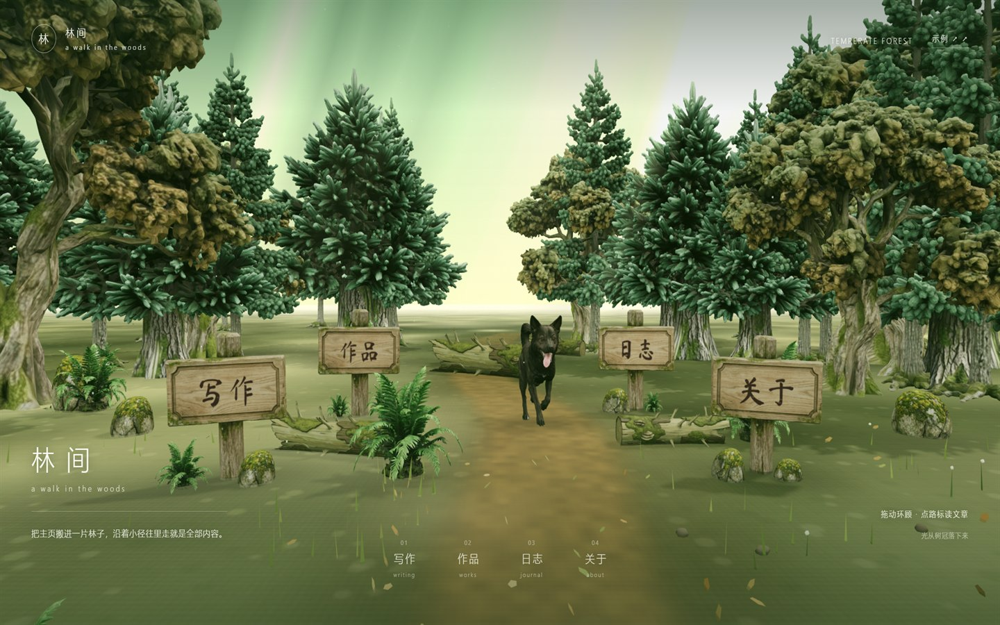
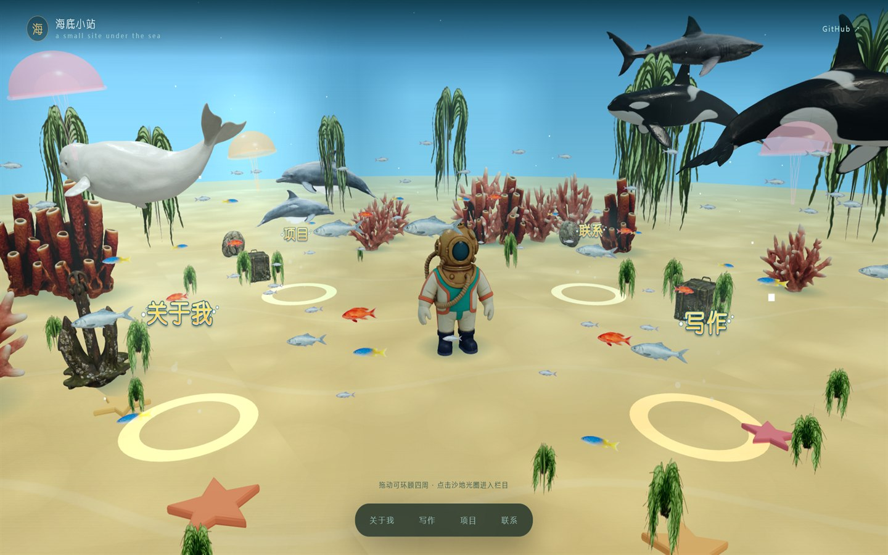
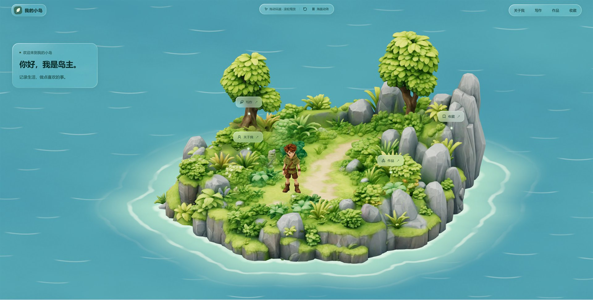

# Hi3D 个人主页模板

用 [Hi3D](https://hi3d.cn) 生成的 3D 资产，配合 React + three.js 做的个人主页模板合集。每个模板都是一套完整、可独立部署的站点，彼此不共享代码与资源，适合挑一个改成自己的主页，或作为 3D 场景页面的起点。

- 纯静态构建，`pnpm build` 后直接部署 `dist/`
- 3D 模型大多做过减面 + WebP 贴图压缩，海洋版单个 GLB 在 0.6–1.4MB，小岛场景约 7.7MB
- 三套模板都是中性示例内容（森林示例站、海底小站、我的小岛），替换数据文件即可换成自己的

## 在线预览

已通过 GitHub Pages 部署，无需本地运行即可查看：<https://jasondongx.github.io/hi3d-jason-home/>

| 模板 | 在线地址 |
| --- | --- |
| 森林 | <https://jasondongx.github.io/hi3d-jason-home/forest/> |
| 海洋 | <https://jasondongx.github.io/hi3d-jason-home/ocean/> |
| 小岛 | <https://jasondongx.github.io/hi3d-jason-home/island/> |

## 模板一览

| 模板 | 本地地址 | 风格 | 资产目录 |
| --- | --- | --- | --- |
| 森林 · 林间 | `/forest/` | 林间小径 + 木质路标，暖绿自然光 | `public/forest/` |
| 海洋 · 海底小站 | `/ocean/` | 浅海沙地 + 珊瑚鲸群，可拖拽环顾 | `public/ocean/` |
| 小岛 · 我的小岛 | `/island/` | 立体海岛 + 男孩，可环视、海面动效 | `public/island/` |

海洋版是当前最完整的一套：3D 场景里有潜水员、虎鲸、白鲸、鲨鱼、海豚、鱼群、水母、珊瑚与四个悬浮入口，入口文字可直接点击，面板/阅读层与 3D 场景联动。

## 预览

**森林 · `/forest/`** — 林间小径、木质路标与四个可点击入口



**海洋 · `/ocean/`** — 浅海沙地、潜水员与环绕游动的鲸群鱼群



**小岛 · `/island/`** — 立体海岛、岛主与可环视的岛屿场景



## 目录结构

```
.
├─ templates/                   # 每个模板一个独立目录
│  ├─ forest/
│  │  ├─ index.html             # 入口 HTML（独立 root 节点、独立 CSS/JS）
│  │  ├─ src/                   # 组件、场景、样式、数据
│  │  └─ content/               # 示例内容包（demo.json 随仓库提交）
│  ├─ ocean/
│  │  ├─ index.html
│  │  └─ src/
│  └─ island/
│     ├─ index.html
│     └─ src/                   # TSX 源码，Vite 直接编译
├─ public/                      # 静态资产，按模板分目录，构建时原样拷贝
│  ├─ forest/                   # models / content / fonts / favicon
│  ├─ ocean/                    # models / assets / tex
│  └─ island/                   # assets（island.glb / boy.glb / 海浪贴图）+ 内容与场景 JSON
├─ scripts/                     # 内容生成与本地预览脚本
├─ docs/previews/               # README 预览截图（JPEG，约 200–360KB/张）
├─ vite.config.js               # 多入口配置（root 指向 templates/）
└─ package.json
```

构建后输出：

```
dist/
├─ forest/index.html    + dist/forest/models|content|fonts...
├─ ocean/index.html     + dist/ocean/models|assets|tex...
├─ island/index.html    + dist/island/assets...
└─ assets/              # 打包后的 JS/CSS
```

## 开发与构建

```bash
pnpm install
pnpm dev        # http://127.0.0.1:5173/forest/ · /ocean/ · /island/
pnpm build      # 输出到 dist/
pnpm preview    # 预览构建结果
```

本地和根域名部署默认以 `/` 为 base，三个模板的访问路径分别是 `/forest/`、`/ocean/`、`/island/`；子路径部署时用 `VITE_BASE` 覆盖。

### 部署到 GitHub Pages

仓库自带 [`.github/workflows/pages.yml`](.github/workflows/pages.yml)：推送到 `main` 会自动构建并发布 `dist/`。

1. 仓库 Settings → Pages → Source 选择 **GitHub Actions**；
2. 首次推送后等待 Actions 完成，访问：

```
https://<用户名>.github.io/<仓库名>/            # 模板导航首页
https://<用户名>.github.io/<仓库名>/forest/
https://<用户名>.github.io/<仓库名>/ocean/
https://<用户名>.github.io/<仓库名>/island/
```

项目站点在子路径下，工作流会自动用 `VITE_BASE=/<仓库名>/` 构建；如果仓库名本身是 `<用户名>.github.io`（用户站点，跑在根路径），把工作流里的 `VITE_BASE` 改成 `/` 即可。

## 模板隔离约定

新增或修改模板时，请保持以下边界，避免相互污染：

1. **代码**：模板之间不 import 对方的组件、场景或数据。三个模板当前都没有跨目录 import，可随时用 `grep` 复核。
2. **入口**：每个模板自己的 `index.html`，独立的挂载节点（森林 `#root`、海洋 `#ocean-root`、小岛 `#root`），互不覆盖。
3. **样式**：海洋版类名统一 `o-` 前缀；小岛版是语义化类名，但只在自己的入口里加载自己的 CSS 模块，不共享样式表。
4. **资产**：统一放 `public/<模板名>/`。森林/海洋用 `/模板名/...` 绝对路径，小岛沿用它自己的相对路径 `./assets/...`（入口在 `/island/` 下，解析结果同样指向自己的目录）。
5. **构建**：`vite.config.js` 中每个模板一个 rollup input，输出到 `dist/<模板名>/`。

### 新增模板清单

1. 建 `templates/<name>/index.html` 与 `templates/<name>/src/`（入口脚本、场景、样式、数据）；
2. 资产放 `public/<name>/`，代码里用 `/name/...` 引用；
3. 在 `vite.config.js` 的 `rollupOptions.input` 增加一项；
4. 在本 README 的模板一览里补一行。

## 内容替换

### 森林版

- `templates/forest/content/demo.json` 是随仓库提交的中性示例，标题、栏目、文案、模型清单都在这里。
- 想把个人内容搬进来时，复制 `templates/forest/content/owner.example.json` 为 `owner.json`，然后：

```bash
pnpm content:sync     # 生成 templates/forest/content/site.json 与 public/forest/content/library.json
pnpm content:reset    # 清掉成品内容，回到中性示例
```

`site.json`、`owner.json`、`public/forest/content/` 与个人 GLB 都被 `.gitignore` 排除，模板仓库本身不携带个人资料。

### 海洋版

- 所有文字都在 `templates/ocean/src/data/ocean-content.json`（品牌、四个栏目、文章、项目、联系方式、关于页）。
- 也可以修改 `scripts/build-ocean-content.mjs` 里的示例文案后执行 `node scripts/build-ocean-content.mjs` 重新生成。
- 四个入口的文案由 `sections` 决定：`label` 显示在 3D 贴纸字上，`kind` 决定面板形态（`about` / `list` / `links`）。

### 小岛版

- 文案与栏目在 `public/island/hi3d-content.json`：昵称、简介、关于我、写作、作品、收藏、联系方式。
- 场景布局、镜头、灯光与模型引用在 `public/island/hi3d-scene.json`；模型与贴图都在 `public/island/assets/`。
- 代码是 TSX，入口 `templates/island/src/hi3d-main.tsx`，Vite 直接编译，无需额外 TS 构建步骤。

## 3D 资产说明

- Hi3D 导出的原始 GLB 通常几十兆，建议先减面并压缩贴图再放进 `public/<模板>/models/`：

```bash
npx @gltf-transform/cli optimize in.glb out.glb \
  --compress quantize --texture-compress webp --texture-size 1024 \
  --simplify-ratio 0.02 --simplify-error 0.01
```

- 2D 生物（鱼群、鲨鱼、海豚）用透明 PNG + billboard 面片，成本远低于 3D，近看仍自然。
- 没有配置模型时，各模板的备用几何仍可正常显示场景。
